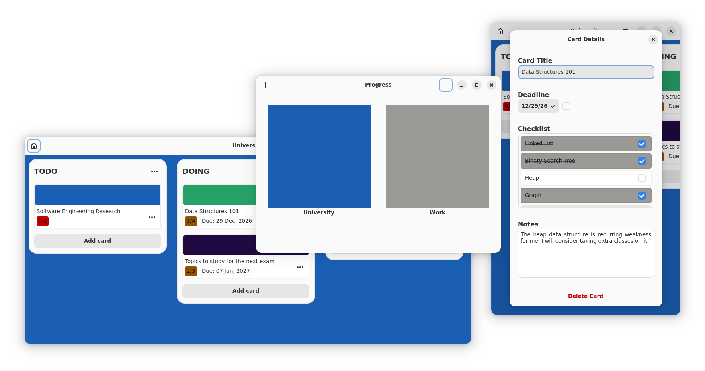

# ![progress-logo] Progress

Simple Kanban board manager

[![GitHub Release][github-release-badge]][github-release]
[![Flathub Downloads][flatpak-release-badge]][progress-flathub]
[![GitHub License][github-licence]](LICENSE)
![Build Status][build-status]



## About Progress

Progress is a Kanban board management app designed to be simple yet flexible for
most workflows. Whether you're managing software projects or organising
daily tasks, Progress keeps things straightforward. Built with C++ with GTK4
and LibAdwaita.

* Keyboard-centred workflow support
* Support drag-and-drop gestures
* Basic card customisation
* Responsive design

## Installation

### Flatpak

```sh
flatpak install flathub io.github.smolblackcat.Progress
```

### Debian Stable

[See the releases section](https://github.com/smolBlackCat/progress-tracker/releases)

### Arch Linux (AUR)

```sh
yay -S progress-tracker
```

### Windows

[See the releases section](https://github.com/smolBlackCat/progress-tracker/releases)

## Building From Source

Alternative for those who want to contribute to the project somehow or want
a custom build. Ensure all dependencies are installed beforehand and verify
whether the system's C++ compiler is C++20 compliant.

## Dependencies

* gtkmm-4 (>= 4.10.0)
* libadwaita1 (>= 1.5)
* tinyxml2 (>= 10.0.0)
* spdlog (>= 1.12)
* crossguid (git submodule)

### Docker

```sh
git clone https://github.com/smolBlackCat/progress-tracker.git --recursive
cd progress-tracker
docker compose up
```

### Linux

<details>
   <summary>Debian/Ubuntu</summary>
   ```sh
   sudo apt install cmake libgtkmm-4.0-dev libadwaita-1-dev libtinyxml2-dev \
    libspdlog-dev gettext catch2
   ```
</details>

<details>
   <summary>Fedora</summary>
   ```sh
   sudo dnf install gcc-c++ cmake ninja-build gettext gtkmm4.0-devel \
   libadwaita-devel tinyxml2-devel spdlog-devel Catch2-devel
   ```
</details>

<details>
   <summary>Arch Linux</summary>
   ```sh
   sudo pacman -S --needed base-devel cmake ninja gettext gtkmm-4.0 \
   libadwaita tinyxml2 spdlog catch2
   ```
</details>

1. Clone the project's repository

   ```sh
   git clone https://github.com/smolBlackCat/progress-tracker.git --recursive
   ```

2. Configure and compile the project.

   ```sh
   cd progress-tracker/

   cmake -S . -B build/ -DCMAKE_INSTALL_PREFIX=/usr -DDEVELOPMENT=OFF
   cmake --build build/
   ```

3. Install the project

   ```sh
   # There's no need for sudo if you set to a local install prefix
   # (e.g. ~/.local/)
   sudo ninja install -C build/
   sudo glib-compile-schemas /usr/share/glib-2.0/schemas/
   ```

### Windows (MSYS2)

1. Install the dependencies

   ```sh
   # This snippet assumes you're running on the UCRT64 environment
   pacman -Syu mingw-w64-ucrt-x86_64-cmake mingw-w64-ucrt-x86_64-python mingw-w64-ucrt-x86_64-gtkmm-4.0 mingw-w64-ucrt-x86_64-libadwaita mingw-w64-ucrt-x86_64-tinyxml2 mingw-w64-ucrt-x86_64-gettext mingw-w64-ucrt-x86_64-catch mingw-w64-ucrt-x86_64-spdlog mingw-w64-ucrt-x86_64-nsis git
   ```

2. Clone the project's repository

   ```sh
   git clone https://github.com/smolBlackCat/progress-tracker.git --recursive
   ```

3. Configure and compile project

   ```sh
   cd progress-tracker/
   cmake -S . -B build/ -DDEVELOPMENT=OFF
   cmake --build build/
   ```

4. Build the Progress installer and ZIP file

   ```sh
   cd build/

   # Builds a Windows installer executable
   cpack
   ```

## Consider Supporting the Project

[](https://ko-fi.com/T6T71MK1CZ)

[progress-logo]: data/io.github.smolblackcat.Progress.svg
[progress-flathub]: https://flathub.org/apps/io.github.smolblackcat.Progress
[github-release]: https://github.com/smolBlackCat/progress-tracker/releases
[github-release-badge]: https://img.shields.io/github/v/release/smolBlackCat/progress-tracker?logo=github
[flatpak-release-badge]: https://img.shields.io/flathub/downloads/io.github.smolblackcat.Progress?logo=flathub
[github-licence]: https://img.shields.io/github/license/smolBlackCat/progress-tracker
[build-status]: https://img.shields.io/github/actions/workflow/status/smolBlackCat/progress-tracker/progress-ci.yml